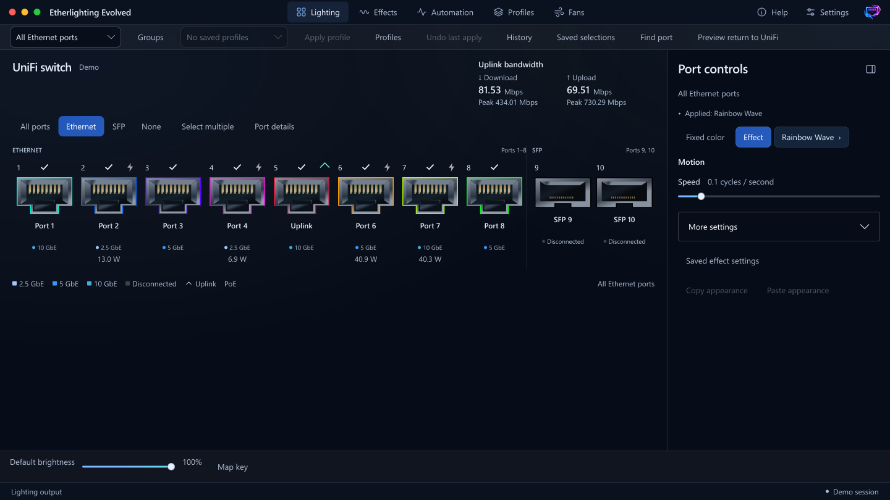
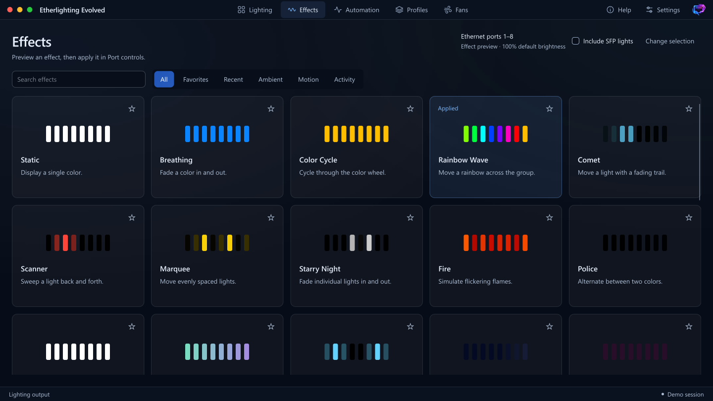
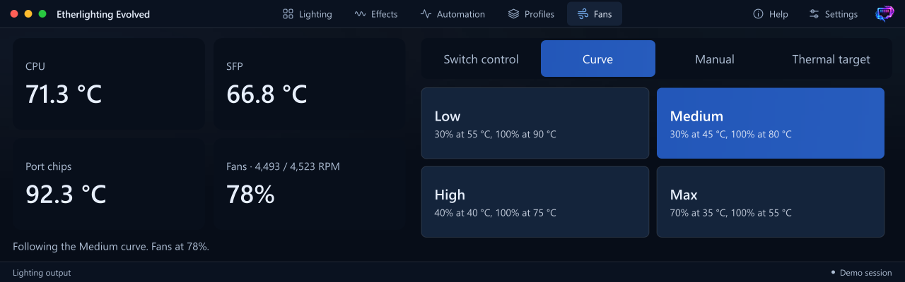
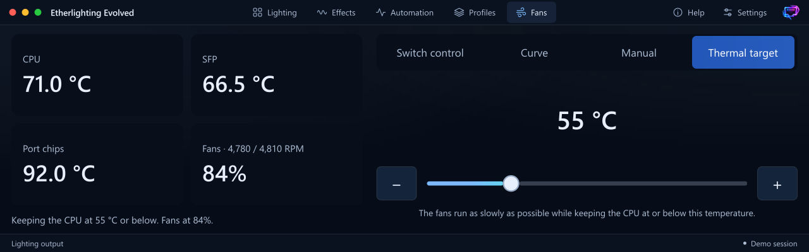
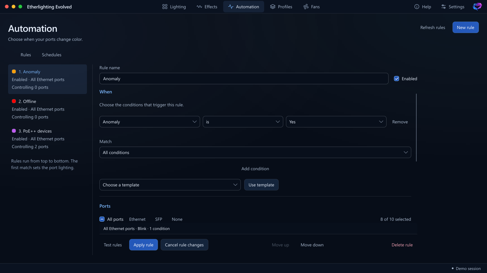
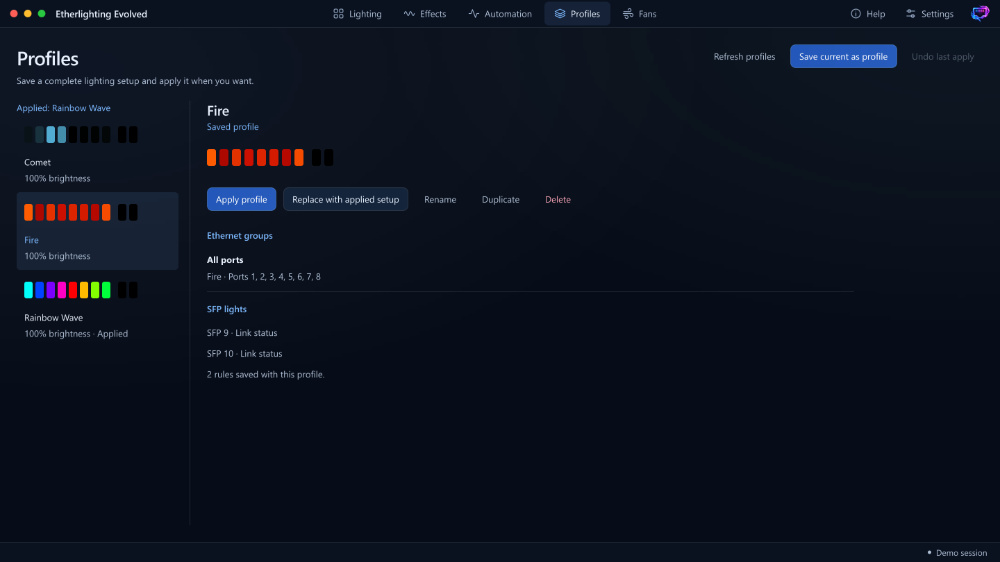

# Etherlighting Evolved

Etherlighting Evolved (EE) controls the port lights (Etherlighting) of UniFi switches over SSH and, on a USW-Pro-XG-8-PoE, the switch fans. Select ports, preview colors and effects, then apply them to the switch. Connect UniFi Network to add device names and port telemetry.

## Unofficial software

EE is an unofficial project. It is not affiliated with, endorsed by or sponsored by Ubiquiti Inc. UniFi and Etherlighting are trademarks of Ubiquiti Inc.

EE logs in to the switch over SSH and uses interfaces on the switch that Ubiquiti does not document or support. Use it at your own risk. It is provided under the MIT license, without warranty.

Only the USW-Pro-XG-8-PoE has been tested on a physical switch. The other models in the [hardware list](docs/HARDWARE.md) were checked against their firmware, not on hardware. At every login EE checks the model, the firmware build and the lighting interface, and it refuses lighting output on a model or firmware build that has not been reviewed. A firmware update can therefore block output until the new build is reviewed.

## Features

The desktop app has Lighting, Effects, Automation, Profiles, Fans, Settings and Help pages.

- Set colors and brightness for single ports or groups, and preview animated effects before applying them.
- Color ports by link status, traffic, PoE usage, anomalies or a schedule, and test rules against a port and time.
- Run effects on the SFP indicators, or set them one by one, together, or to follow an Ethernet port.
- Save lighting as a profile, apply it later, or undo the last apply. Weekly schedules can apply a profile, change brightness or hand lighting control to UniFi.
- Rename ports or use their names from UniFi Network, and see uplink download and upload speeds.
- On a USW-Pro-XG-8-PoE, set the fans to Switch control, a Low, Medium, High or Max curve, Manual (one fixed speed) or Thermal target, and see the CPU, SFP and port chip temperatures. Fan control is in the desktop app only.
- Open the workspace from a phone or another computer through Tailscale, or on your own network with LAN access. Both are optional and off until you turn them on.

## Screenshots

These images show the desktop app in its demo session with the Midnight theme.

The Lighting page with the Rainbow Wave effect applied to the Ethernet ports:



The Effects page, where each effect is previewed before it is applied:



The Fans page in a rack-sized window, following the Medium curve:



The Fans page with a thermal target of 55 °C:



The Automation page with rules for anomalies, offline ports and PoE++ devices:



The Profiles page with three saved profiles:



## Requirements

- A computer with 64-bit Windows 10 or later. EE controls switches from Windows only.
- A switch from the [hardware list](docs/HARDWARE.md), its IP address, and the SSH username and password set for your devices in UniFi Network. EE signs in with that username and password; no SSH key is needed.
- UniFi Network, if you want device names and port telemetry.
- Tailscale on the Windows computer and on each other device, only if you want to open EE from elsewhere over an encrypted connection. LAN access works on your own network without Tailscale.

The macOS client (macOS 12 or later, Apple silicon or Intel) and the Linux client (x64 or arm64) do not connect to a switch themselves. They open the workspace of a Windows computer that runs EE, through its private Tailscale address or, with LAN access, its address on your network.

## Install

Download the files from the [releases page](https://github.com/Views2k/etherlighting-evolved/releases). Each release has these files:

| File | Contents |
| --- | --- |
| `EtherlightingEvolved-Setup-<version>.exe` | Windows installer: the desktop app, the workspace service and the lighting engine |
| `EtherlightingEvolved-<version>-osx-arm64.zip`, `EtherlightingEvolved-<version>-osx-x64.zip` | macOS client for Apple silicon and for Intel |
| `EtherlightingEvolved-<version>-linux-x64.tar.gz`, `EtherlightingEvolved-<version>-linux-arm64.tar.gz` | Linux client |
| `SHA256SUMS` | SHA-256 checksums of the installer and the client archives |
| `package-verification.json` | Record of the checks the release build ran on the Windows package |

GitHub Actions builds each release from a version tag. The Windows installer has no Authenticode signature yet, so Windows SmartScreen can warn before Setup runs. The macOS app has an ad hoc signature but is not signed with a Developer ID or notarized, so macOS blocks it the first time it opens; choose **Open Anyway** in System Settings → Privacy & Security (System Preferences → Security & Privacy on macOS 12). Verify a download before you run it.

### Verify a download

Compare the file's SHA-256 checksum with its line in `SHA256SUMS`.

[WINDOWS POWERSHELL]

```powershell
(Get-FileHash .\EtherlightingEvolved-Setup-<version>.exe -Algorithm SHA256).Hash.ToLower()
```

[MACOS TERMINAL]

```sh
shasum -a 256 EtherlightingEvolved-<version>-osx-arm64.zip
```

[LINUX TERMINAL]

```sh
sha256sum EtherlightingEvolved-<version>-linux-x64.tar.gz
```

The installer and each client archive also have a build provenance attestation that ties the file to the commit and workflow run that built it. Check it with the [GitHub CLI](https://cli.github.com/):

```sh
gh attestation verify EtherlightingEvolved-Setup-<version>.exe --repo Views2k/etherlighting-evolved
```

### Windows

Run Setup. It asks whether to install EE for you only or for all users, and it can start EE when you sign in to Windows. Updating EE keeps your data and the Start with Windows setting.

### macOS and Linux

Extract the archive. On macOS, open `EtherlightingEvolved.app`. On Linux, run `./EtherlightingEvolved` in the extracted folder. Choose **Change workspace address** and enter the address shown under Tailscale private access or LAN access in Settings → Remote on the Windows computer. The [desktop guide](desktop/README.md) has the details, including LAN pairing and approving a tagged Tailscale device.

## First run

1. Start Etherlighting Evolved from the Start menu. The app starts its workspace service. Choose **Continue with demo** to try the controls on a simulated switch.
2. To connect a switch, enter its address, SSH username and password. The first connection saves the switch's SSH key, as described under [SSH host keys](#ssh-host-keys).
3. Select **Save login on this PC** to let EE reconnect after a restart. Windows protects the saved login for your Windows account.
4. In Settings → UniFi, select your controller and sign-in method to add device names and port telemetry.
5. To open the workspace on other devices, turn on Tailscale private access or LAN access in Settings → Remote, as described under [Remote access](#remote-access).

Closing the window keeps EE running in the notification area. Choose **Quit** in the tray menu to stop it. To use the workspace in a browser on the same computer, choose **Open in browser** in the tray menu or in Settings → Connection. The desktop app opens that tab with a one-use link that gives it administration access; the administration key that EE creates at each start stays in the app. A browser tab opened another way shows the Tailscale and LAN access settings read-only and cannot close the workspace.

### SSH host keys

A first login, a reconnect with the saved login or the connection at startup to a switch that has no saved SSH key signs in with the username and password and then saves the switch's key (trust on first use, as in release 0.5.1). EE does not require an SSH key on the switch; a regular username and password login works, and you decide whether that is enough for your network. Keys saved by earlier releases are used as they are.

While a switch is connected, Settings → Connection shows the saved key's SHA256 fingerprint and key type, as `ssh-keygen -l` prints them, so you can compare it with what an SSH client shows. If the switch later presents a key that differs from the saved one, EE refuses the connection before it sends the username or password, and the Connect page shows the saved and the new fingerprints. The new key can be accepted only in EE on the computer that runs it. Accept it only after you have reset or replaced the switch; otherwise another device may be using the switch's address. Accepting it clears EE's record of the lighting player on the previous switch. Lighting, schedules and port names saved for the previous key stay on disk but are not used with the new key.

## Remote access

EE can open its workspace on phones and other computers through Tailscale or through LAN access. Both are optional and off until you turn them on in Settings → Remote on the Windows computer, and both can be on together. Once turned on, they run whenever EE's service runs on that computer, including before a switch is connected and while you use **Continue with demo**. The separate demo that the app opens with `--demo` and a source run in simulator mode have neither.

Devices on Tailscale and paired LAN devices have the same limits. They can change lighting, effects, automation, profiles, schedules and port names, control fans in the desktop app, reconnect to the switch whose login is saved on the Windows computer, and choose Handoff to UniFi. Logging in to a new switch, forgetting the saved login, UniFi Network setup, the Tailscale and LAN access settings and accepting a changed SSH key work only in EE on the Windows computer that runs it.

### Tailscale

Tailscale is not required. Private access is off until you select **Use Tailscale**, and while it is off EE runs no Tailscale command. The one exception is a route that EE added earlier and has not yet seen removed, for example because Tailscale was not running when you turned private access off: EE then reads `tailscale serve status` at each start, refresh and quit until a start or refresh sees the route gone. When it is on, EE publishes the workspace at a private HTTPS address in your tailnet with Tailscale Serve, on port 8444 by default, and Tailscale encrypts the connection. EE never uses Tailscale Funnel. Private access admits your Tailscale account, or every account in the tailnet if you choose that, and tagged devices that you approve one by one on the Windows computer. EE adds its Tailscale Serve route when it starts and removes it when it quits.

### LAN access

LAN access lets devices on your own network open EE at the Windows computer's address, without Tailscale. It is off by default. Select **Allow devices on my network** under LAN access and choose **Apply setting** to turn it on. EE then listens on port 4280, or another port that you choose under Connection options while LAN access is off, on IPv4 only, and accepts connections only from private IPv4 addresses. Each device pairs with a 6-digit code that EE shows on the Windows computer when you choose **Pair a device**. A code works once and ends after 5 minutes. Paired devices stay paired until you remove them; turning LAN access off removes all of them. A browser keeps its access key for one year and then needs a new code, while its old entry stays listed until you remove it; the desktop apps keep their keys with no time limit. Do not forward the LAN port on your router.

LAN access uses plain HTTP, so the traffic between your devices and the Windows computer is not encrypted. Anyone who can watch the network can read what crosses it: lighting, fan and handoff commands, the switch address, SSH port and SSH username, the switch model and port status, port names, profiles, schedules and rules, saved effect settings, device names and telemetry from UniFi Network, fan readings, the Tailscale private address when private access is on, the pairing code once, and the device's access key, which every request carries. With a copied key, someone can do anything a paired device can until you remove that device or turn LAN access off. Switch passwords, UniFi Network passwords and API keys never cross the network, because switch login and UniFi Network setup work only on the Windows computer. Use Tailscale when you need an encrypted connection. The [desktop guide](desktop/README.md#connect-over-your-network-without-tailscale) covers pairing and the Windows firewall prompt.

## What EE changes on the switch

While it is connected, EE sets the port lights through the switch's own lighting service and leaves that service running. EE does not install firmware, load kernel modules or change the switch's network configuration.

Two features leave a program running on a USW-Pro-XG-8-PoE after EE closes. Both run from the switch's memory, and a switch restart removes them.

When the switch login is saved and the firmware passes EE's playback checks, EE copies a lighting player to `/tmp/ee-lighting-playback-v1`. The switch keeps showing your lighting, including traffic effects, while EE is closed.

A fan mode other than Switch control runs from `/tmp/ee-fan-control-v1`. While it runs, the switch's own fan service is paused. The service takes the fans back when EE's fan control stops or fails. EE saves the fan mode for each switch, and a switch that EE has not controlled before starts in Switch control. The fan mode chosen in release 0.5.1 moves to the first USW-Pro-XG-8-PoE that EE connects to after the update. Because EE's fan program changed, that first connection restarts it on the switch once with the same mode; the switch's own fan service runs the fans while it restarts. On other switches, EE stops fan control that release 0.5.1 started, on this or another computer, and the switch's own fan service runs the fans until you choose a mode. Fan control that EE on another computer started with release 0.6.0 or later keeps running until you choose a mode.

### Return the switch to UniFi

Choose **Handoff to UniFi** in Settings. EE stops its lighting and the lighting player, returns the fans to the switch's own controller, closes the SSH connection, and waits until you connect again. Saved logins, profiles, the lighting setup and the fan mode of each switch are kept. To return only the fans, choose **Switch control** on the Fans page.

Uninstalling EE does not connect to the switch. Before you uninstall, connect to each switch EE controls and choose **Handoff to UniFi**. Otherwise the lighting player and fan control keep running on the switch until it restarts.

## Data and logs

On Windows, EE keeps its data in two folders. The uninstaller removes the program and leaves both folders in place, except that an uninstall for one user deletes `lan-access.json`, so a later installation starts with LAN access off and no paired devices. An uninstall for all users cannot reach that file; turn LAN access off before you uninstall to remove the paired devices.

| Folder | Contents |
| --- | --- |
| `%USERPROFILE%\.etherlighting-evolved` | Saved switch and UniFi Network logins (encrypted with Windows DPAPI for your account), saved SSH host keys (`known_switches.json`), lighting, profiles, schedules, port names, the fan mode of each switch in `device-fans`, the switch playback record and the output ownership records in `output-ownership` |
| `%LOCALAPPDATA%\Etherlighting Evolved` | Desktop app settings and `desktop.log`, and `workspace-keys.json` with the access keys from LAN pairing when the app was opened with `--url` and paired with another computer. `workspace` holds the Tailscale private access setting (`private-access.json`), approved Tailscale devices (`approved-device.json`), the LAN access setting and paired devices (`lan-access.json`) and `service-diagnostics.log`. `demo` holds the demo's data. |

The macOS and Linux clients keep their settings, `desktop.log` and the access keys from LAN pairing (`workspace-keys.json`) in `~/Library/Application Support/Etherlighting Evolved` and `~/.config/etherlighting-evolved`. To remove a client, quit it and delete the app or its extracted folder and that data folder. If you turned on **Start at login** in its tray menu, turn it off first, or delete `~/Library/LaunchAgents/com.views2k.etherlighting-evolved.plist` on macOS or `~/.config/autostart/etherlighting-evolved.desktop` on Linux. On Linux, also delete the files that the [desktop guide](desktop/README.md#add-ee-to-the-linux-applications-menu) adds for the applications menu: `~/.local/bin/EtherlightingEvolved`, `~/.local/share/applications/etherlighting-evolved.desktop` and `~/.local/share/icons/hicolor/256x256/apps/etherlighting-evolved.png`.

To remove EE and its data from Windows, choose **Handoff to UniFi** for each switch, uninstall EE in Windows Settings → Apps, then delete both folders. Delete `output-ownership` only after Handoff to UniFi has finished: it records the switches whose lighting EE has to return at the next login. If you used Tailscale private access, EE removes its Tailscale Serve route when it quits, and uninstalling removes it as well when EE was installed for you only. The uninstaller of an installation for all users skips that step. In that case, or when the uninstaller reports that it could not confirm the removal, run `tailscale serve status`; if the port of EE's private address (8444 by default) still forwards to `http://127.0.0.1`, remove it with `tailscale serve --https=<port> off`.

## Reporting a problem

Open an issue on the [issue tracker](https://github.com/Views2k/etherlighting-evolved/issues) with the bug report or hardware report form. Include the EE version from Settings → About, your Windows version, and the switch model and firmware.

The workspace service writes `%LOCALAPPDATA%\Etherlighting Evolved\workspace\service-diagnostics.log`. It records the time, the event, the EE version, error types, code locations, EE's fixed error codes and EE's log message templates without their values. It records no hosts, names or passwords, so you can attach it to an issue. `desktop.log` records the desktop app's errors and the last output lines of a service that stopped. Those lines can include file paths and addresses, so read the file before you attach it.

Report security vulnerabilities privately as described in [SECURITY.md](SECURITY.md), not in a public issue. Outside pull requests are not accepted; see [CONTRIBUTING.md](CONTRIBUTING.md).

## Build from source

Builds use Python 3.14 (`.python-version`), Node.js 24.18.0 (`.node-version`; running from source needs Node.js 22 or later), the .NET 10 SDK (`global.json`) and, for the installer, Inno Setup 6.7. To try the simulator from a Windows checkout, with Python 3.14 and Node.js on the path:

[WINDOWS POWERSHELL]

```powershell
python -m venv .venv
.\.venv\Scripts\python.exe -m pip install --require-hashes --only-binary=:all: -r requirements-ci.txt
.\.venv\Scripts\python.exe -m pip install --no-deps --no-build-isolation -e .
$env:EE_PREVIEW_LIVE = '0'
npm start
```

Open [the local workspace](http://127.0.0.1:4180). `npm start` also prints an administration link that works once; a browser that opens it can change the Tailscale and LAN access settings until the browser session ends or `npm start` stops. The simulator keeps its own data in `outputs/browser-preview-data/`. Set `EE_PREVIEW_LIVE` to `1` to log in to a switch instead; live mode runs on Windows only. The [development guide](docs/DEVELOPMENT.md) covers macOS and Linux, tests and the [Windows installer build](docs/DEVELOPMENT.md#windows-installer). The [desktop guide](desktop/README.md#build-and-test) covers the desktop app.

## Repository layout

| Directory | Contents |
| --- | --- |
| `desktop/` | Desktop app, its checks and the macOS and Linux client packaging |
| `preview/` | Workspace gateway, Tailscale and LAN gateways and browser workspace |
| `src/etherlighting_evolved/` | Python lighting engine, API, switch adapters and the programs EE runs on the switch |
| `src/*.mjs` | Effect catalog, color, rule and icon modules shared by the browser workspace |
| `assets/` | Logo, favicon and web app icons |
| `tests/` | Python and JavaScript tests and their fixtures |
| `packaging/` | Engine entry point, PyInstaller specification, Windows installer script and build script |
| `tools/` | Build, verification, version and fixture tools |
| `docs/` | API contract, hardware list, development and workflow guides |
| `.github/` | CI and release workflows, issue forms and the pull request template |

## Documentation

The [hardware list](docs/HARDWARE.md) describes the supported models, the firmware review and the programs EE runs on the switch. The [desktop guide](desktop/README.md) covers the desktop app and the macOS and Linux clients. The [development guide](docs/DEVELOPMENT.md) covers the source setup, tests, data locations and the installer build. [INTEGRATION.md](docs/INTEGRATION.md) describes how the clients, the gateway and the engine work together, and [API.md](docs/API.md) is the API contract. [WORKFLOW.md](docs/WORKFLOW.md) describes branches, pull request checks and releases. Changes are listed in the [changelog](CHANGELOG.md).

## License

[MIT](LICENSE), copyright Views2k. Packaged third-party components keep their own notices and licenses.
